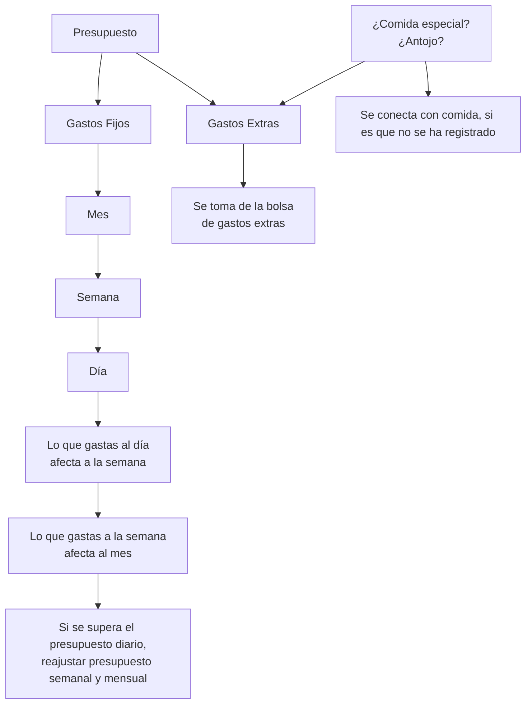

Vamos a crear y replantar varias funciones para este launcher. Algunas de las cosas no tienen que ser nativas del launcher y tendremos que hacer una “app” desde cero. Tienes que saber diferenciar que tiene que ir en que sin romper el funcionamiento.

Vamos a crear un nuevo sistema de recordatorios. Estos tienen que ser reactivos SIN TEXTOS, va a tener un diseño visual. 

Tendra: 

## **Notas Rápidas**:
Para diferentes aspectos (Trabajo, Escuela, Ejercicio - Comida - Dieta(conectado a los modulos que tenemos).
Como función durante el día tambien se mostraran animaciones que den a entender cuantos pendientes y de que aspectos tengo más (aun no pienso en el diseño). Estos se mostraran con cierta frecuencia en su propio widget. 

## **Finanzas**: 
**¿Como va a funcionar o como me lo imagino yo?** Tenemos un ingreso, lo dividimos en categorías, la pregunta es ¿Es un ingreso para mi estabilidad económica? Si la respuesta es sí, entonces:
Lo sumamos a nuestros ingresos = presupuesto. → presupuesto total → ¿Cuales son nuestros gastos fijos y cual es su suma? - - dependiendo de la cantidad → Gastos Fijos - Presupuesto Total → ¿Cual es nuestra capacidad de ahorro? La función de poder modificar nuestro porcentaje de ahorro → La cantidad que tenemos para gastos extras.
Si la respuesta es no, entonces:
¿Qué fue? → Transferencia, regalo, o pago de servicio externo.

Aqui tengo un diagrama de como funciona: 

Tendriamos un presupuesto del comida al día, o un presupuesto x para algo x (o sea que esto se pueda editar)

Registrar un gasto extra

Poder registrar si se pago una cuenta comunal y esperar el dinero de los demás

Tener un registro inteligente de las comidas que esten fuera del presupuesto y marcarlo como un gasto extra.

El registro de ingresos, que tipo de ingreso fue: mesada o salario (ingreso fijo), transferencia  
  
Todavia no tengo claro el diseño de la vista, pero tenemos que mostrar presupuesto, ahorro, gastos fijos, gastos extras, transferencias. 

##
